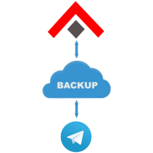

# Telegram automated db backup



This repo provides a Python script that does a **daily backup** and upload it automatically to a Telegram group chat.
This way, you do not need to take care of where to save the backups or buying any cloud service.


## How does it work?

The Python script it's based on:
- pyrogram
- unix commands (like mysqldump, 7z)

**Pyrogram** is a python framework which allows you to use your [Telegram](https://telegram.org) account, so with this framework you can send a message, files, pictures etc. automatically without doing it manually.

Every database is dumped once with `mysqldump` and streamed straight into an AES-encrypted 7z archive, one per database, split in parts of at most 1400 MB because Telegram refuses bigger uploads.
Each archive is then sent to the chat you choose and deleted once Telegram confirms it: a failed upload is retried, and whatever could not be sent stays on disk.


### Requirements

To use the script `bak.py` you need:
- a Telegram account
- python3
- pyrogram
- tgcrypto (optional, but recommended)
- 7z (package `7zip`, or `p7zip-full` on older distros)
- mysql-client (for mysqldump)

To install these software in a Linux distro **Debian-based** you can run:
```bash
$ sudo apt install python3 python3-pip 7zip mysql-client
```

To install the python packages you can use the python package manager **pip**:
```
$ pip3 install -r requirements.txt
```

### Configuration
Please replace the following values with your personal data
```python
# database connection config
mysql_localhost = "localhost"
mysql_port = 3306
mysql_username = "USERNAME"
mysql_password = "PASSWORD"

world_db = "acore_world"
char_db = "acore_characters"
auth_db = "acore_auth"

# (database, short name used for its archive)
databases = [
    (world_db, "world"),
    (char_db, "characters"),
    (auth_db, "auth"),
]

# archive config: every run produces db-YYYYMMDD* files; an archive larger than
# volume_size is split in parts of at most that size (Telegram refuses uploads above 2 GB)
archive_password = "db_zipped"
archive_prefix = "db-{:%Y%m%d}".format(datetime.now())  # e.g. "db-20211231"
volume_size = "1400m"

# replace "me" with a chat_id or username to change the chat
chat_id = "me"
# Telegram client config
username = ""
api_id = ""
api_hash = ""

# upload retries: wait retry_wait_seconds after a failure (doubled each time, up to
# 10 minutes), give up after send_attempts tries and keep the archive on disk
send_attempts = 20
retry_wait_seconds = 30
```

### Usage

To allow pyrogram to use your account you need to have an username on Telegram and create a Telegram 3rd "app" here: https://my.telegram.org/auth?to=apps.
Generated the app, this app will have **api_id** and **api_hash**, put these data into the conf part in`bak.py`.

Afterward, fill the mysql credentials and the archive password and run the python script using
```bash
$ python3 bak.py
```

Note: alternatively, you can also run `bak-per-table.py` if you want a zip archive with one file per table instead of one 7z archive per db.

The first time, pyrogram will need from your telegram account a TOKEN that you will receive on Telegram, after this, pyrogram will generate a sqlite database in the same directory of bak.py to keep the session with your Telegram user.

Finally, you just need to run the script bak.py and your databases will be pushed in your personal chat ("Saved Messages" / "me"), one encrypted 7z archive each.

You can change the chat where to push the archives, replacing "me" in `chat_id` with a chat_id or a Telegram @Username,
if you don't know your chat_id you can ask [@username_to_id_bot](https://t.me/username_to_id_bot) to get it.
A numeric chat_id only works if your account already has a conversation with that chat: for a user, they must have written to you at least once.

### Restore

Extract the archive (7z asks for the archive password) and load the dump:
```bash
$ 7z x db-20211231-world.7z.001
$ mysql -u USERNAME -p acore_world < world.sql
```

### Optional, run it daily using crontab

To run the script daily you can create a cronjob using `crontab` (usually it is installed as default on a Linux server).
So open crontab using:
```
$ crontab -e
```

Fill the last line with:
```
0 0 * * * cd ~/root/path/project/; python3 bak.py
```

This will run the script daily on at midnight 😉.

That's all!
Open an issue if you need anything.


## Development

Install the development tools, which include the runtime requirements:
```
$ pip3 install -r requirements_dev.txt
```

Then lint and type-check the scripts, the same checks the GitHub workflow runs on every push and pull request:
```
$ ruff check .
$ ty check
```


## Credits
- [Helias](https://github.com/Helias)
